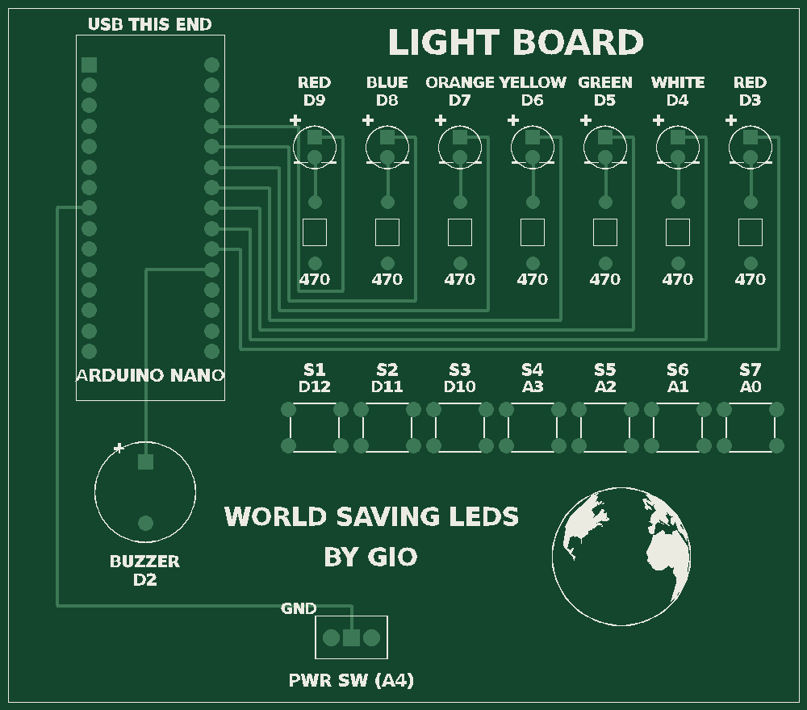

# Light Board ("World Saving LEDs")

Gio's first custom PCB: a Simon Says game. Seven colored LEDs, seven buttons, a passive piezo buzzer and a slide switch sit on a 98 × 86 mm two-layer through-hole board, run by a socketed Arduino Nano. The board lights a growing sequence and you repeat it on the buttons.

This repo also holds an earlier, separate layout, the 7-channel 9V LED board (`hardware/led-9v-controller/`). It has no microcontroller and is described in its own section below.

Built by Gio ([Built-By-Gio](https://github.com/Built-By-Gio)).

## Status (2026-11-25)

Light Board (Simon Says):

- Built: boards were made by JLCPCB from the gerbers in `hardware/` (dated 2026-09-22) and hand-soldered. Gio reports the assembled board plays Simon Says, with some issues that are not written down yet. There is no photo of the board in this repo.
- Firmware: the original game sketch was lost. `firmware/simon_says/simon_says.ino` is a replacement written to match the pin labels printed on the silkscreen. It compiles for the Arduino Nano (checked 2026-11-25 with arduino-cli 1.5.1 and the arduino:avr 1.8.8 core: 4188 bytes of flash, 112 bytes of RAM). It runs on the assembled board.
- Design source: there is no schematic and no KiCad project for the final board, only the gerber and drill files. The board can be re-ordered as it is, but not edited.

7-channel 9V LED board:

- Layout only; not known to have been manufactured.
- A KiCad 10 design-rule check run on 2026-11-25 reports 128 problems, including 16 +9V-to-GND shorts (each switch's GND pad overlaps the next resistor's +9V pad) and 2 unconnected items (the second row, D6 and D7, is not wired to the screw terminal). Do not order it as it is.

Not documented yet:

- Photo of the soldered board
- Demo video
- Write-up of the known issues
- KiCad project (schematic and layout) for the final Light Board

## What you need

### Light Board parts

There is no BOM file. This table comes from the gerber and drill files in `hardware/gerbers/`: part labels and values from the top silkscreen, hole sizes and spacing from `lightboard-PTH.TXT`.

| Part | Qty | Silkscreen label | Holes (from the drill file) |
|---|---|---|---|
| Arduino Nano | 1 | "ARDUINO NANO", "USB THIS END" | 2 rows of 15, 1.0 mm, 2.54 mm pitch, rows 15.24 mm apart |
| 1×15 female header (socket for the Nano) | 2 | none | same as above |
| 5 mm LED | 7 | RED D9, BLUE D8, ORANGE D7, YELLOW D6, GREEN D5, WHITE D4, RED D3 | 2 per LED, 0.9 mm, 2.54 mm apart |
| 470 Ω resistor, axial | 7 | "470" under each LED | 2 per resistor, 0.8 mm, 7.62 mm apart |
| 4-pin tactile push button | 7 | S1 D12, S2 D11, S3 D10, S4 A3, S5 A2, S6 A1, S7 A0 | 4 per button, 1.0 mm, on a 6.5 × 4.5 mm rectangle |
| Passive piezo buzzer | 1 | "BUZZER D2", "+" mark | 2, 1.0 mm, 7.6 mm apart |
| 3-pin slide switch | 1 | "PWR SW (A4)", "GND" | 3, 1.2 mm, 2.54 mm pitch |

"Passive" for the buzzer comes from the firmware, which drives it with `tone()` at a different pitch for each LED. The Nano socket is how the original board was built; you can also solder the Nano directly.

How the parts connect (traced from the copper layers):

| Part | Nano pin | Circuit |
|---|---|---|
| LEDs, left to right | D9, D8, D7, D6, D5, D4, D3 | pin → LED ("+" pad) → 470 Ω → GND |
| Buttons S1 to S7 | D12, D11, D10, A3, A2, A1, A0 | pin → button → GND (uses the Nano's internal pull-ups) |
| Buzzer | D2 | pin → buzzer "+" → GND |
| Slide switch | A4 | middle pin to A4, the pin next to "GND" to ground, third pin unconnected |

The bottom layer is a ground fill. The Nano's 5V and VIN pins are not connected to anything on the board, so the board is powered through the Nano's USB port. The slide switch does not cut power; it is an input that the sketch reads on A4.

### Tools and software

- Soldering iron and solder for through-hole parts
- Arduino IDE 2.x or arduino-cli, with the "Arduino AVR Boards" core (tested to compile with 1.8.8)
- USB cable for the Nano
- No extra libraries are needed

## How to build and run

1. Order the board. Upload `hardware/lightboard-gerbers.zip` to a PCB maker (the original boards came from JLCPCB). Settings from the files: 2 layers, 98 × 86 mm outline. The drill file uses 0.8, 0.9, 1.0 and 1.2 mm plated holes (91 in total) plus four 3.2 mm unplated mounting holes, 5 mm in from each corner. Board thickness, color and finish are not specified in the files; use the maker's defaults or your choice.
2. Get the parts in the table above.
3. Solder the parts where the silkscreen shows them. Put each LED's long leg (anode) in the pad marked "+". Mount the Nano (or its sockets) with the USB connector at the "USB THIS END" mark.
4. Open `firmware/simon_says/simon_says.ino` in the Arduino IDE. Pick Tools → Board → Arduino Nano and Processor → ATmega328P. If the upload fails on a clone Nano, try Processor → ATmega328P (Old Bootloader). Upload.
   With arduino-cli: `arduino-cli compile --fqbn arduino:avr:nano firmware/simon_says` then `arduino-cli upload -p <port> --fqbn arduino:avr:nano firmware/simon_says`.
5. Power the Nano over USB and slide the switch to the side that connects A4 to GND. If the game only runs with the switch the other way, flip the test in `on()` at the top of the sketch.

How the game plays (from the sketch):

- With the switch on, the LEDs sweep left to right and back with a tone for each one.
- Each round the board adds one random LED to the sequence and plays the whole sequence. Each LED has its own note (C4 to B4). The playback speeds up each round, down to 150 ms per step.
- Repeat the sequence on the buttons. Each button lights its LED and plays its note while held.
- A wrong button, or no press within 3 seconds, ends the game: all LEDs light with a low tone, then the LEDs blink once per round you completed (your score). A new game starts after that.
- Completing 50 rounds plays a win flash and starts over.
- Sliding the switch off turns everything off and resets the game.

## The 7-channel 9V LED board (earlier layout)

A separate, earlier design in `hardware/led-9v-controller/`: seven independent channels, each +9V → 370 Ω resistor → 5 mm LED → switch → GND, fed from a 2-pin screw terminal. There is no microcontroller. Board outline 160 × 70 mm, 2 layers, through-hole. See the Status section: the layout has design-rule errors and has not been checked on a real board.

Parts, from the footprints and values in `LED_9V_Controller.kicad_pcb`:

| Reference | Part | Qty | Footprint in the file |
|---|---|---|---|
| J1 | 2-pin screw terminal, 9V input | 1 | 5.08 mm pitch, 1.5 mm holes |
| R1 to R7 | 370 Ω resistor, axial | 7 | 7.62 mm pitch, 1.0 mm holes |
| D1 to D7 | 5 mm LED: red, blue, orange, yellow, green, white, red | 7 | 2.54 mm pitch, 1.0 mm holes |
| S1 to S7 | 2-pin switch (or wires to an external switch) | 7 | 6 mm pitch, 1.1 mm holes |

370 Ω is not a common stock value; 360 Ω and 390 Ω are the nearest common ones. More notes are in `hardware/led-9v-controller/README.txt`. Open `LED_9V_Controller.kicad_pro` in KiCad to edit it.

## Repo layout

| Path | What it is |
|---|---|
| `firmware/simon_says/simon_says.ino` | Simon Says game for the Light Board |
| `firmware/README.md` | Short flashing notes |
| `hardware/lightboard-gerbers.zip` | Light Board gerber and drill files, ready to upload to a PCB maker |
| `hardware/gerbers/` | The same 8 files, unzipped (copper, mask, silkscreen, outline, drill) |
| `hardware/led-9v-controller/` | The earlier 7-channel 9V LED board: KiCad project, layout and notes |
| `media/silkscreen_from_gerbers.png` | Image of the Light Board's top silkscreen, top copper and outline, rendered from the gerbers |

## Roadmap / future plans

- Write down the known issues on the assembled board and what fixes them
- Photograph the soldered board and record a demo video
- Recover the original schematic and KiCad project, or redraw them from the gerbers, so the board can be edited

## Credits and license

Both boards designed by Gio; the Light Board built by Gio. Released under the MIT License; see `LICENSE`.
